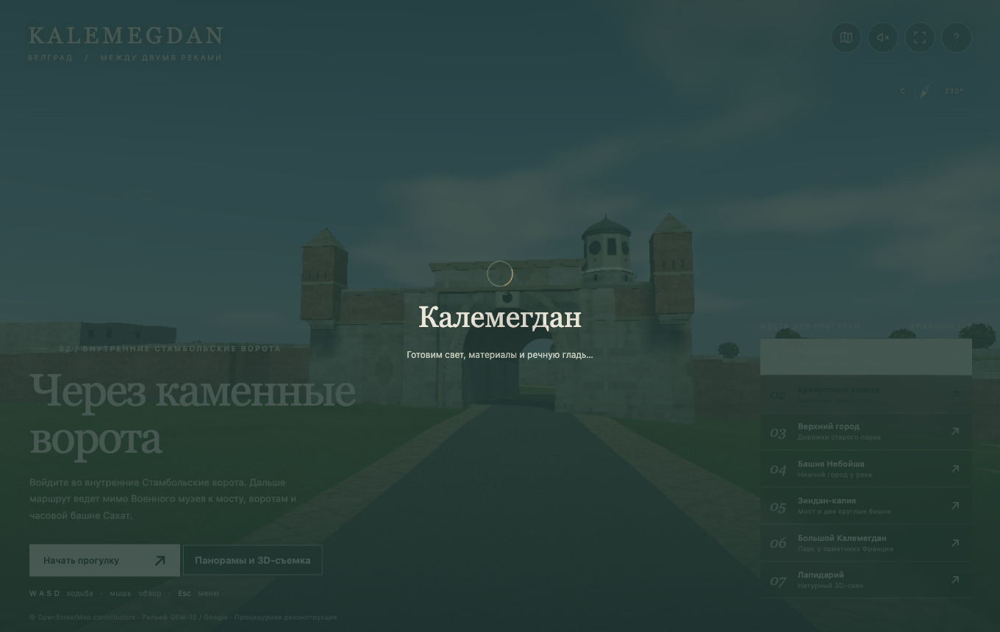

# Калемегдан · Белградская крепость

[Открыть 3D-тур](https://dun4ev.github.io/kalemegdan-3d/)

Прогулка от первого лица по Белградской крепости и парку Калемегдан. В туре семь точек быстрого перехода, карта, синтез звука и встроенный фотограмметрический скан лапидария. Для прогулки нужен браузер с WebGPU. Для просмотра панорам и внешних 3D-моделей нужно подключение к интернету.

Для сборки запустите `python3 work/build.py`. Эта команда обновит автономный файл `docs/index.html`. Для локального просмотра можно запустить `python3 -m http.server 8765 --bind 127.0.0.1 --directory docs` и открыть [локальную страницу](http://127.0.0.1:8765/). Проверка проходов и высот запускается командами `node work/integration-test.cjs --strict` и `node work/terrain-verify.cjs`.

- Координаты взяты из [OpenStreetMap](https://www.openstreetmap.org/copyright). © OpenStreetMap contributors. Производный набор [map-data.json](work/map-data.json) доступен по [ODbL 1.0](https://opendatacommons.org/licenses/odbl/1-0/).
- Рельеф построен на основе [GEM‑15 DTM](https://developers.google.com/earth-engine/datasets/catalog/projects_climate-and-sustainability_assets_gem-15_v1). This dataset is produced by Google. [CC BY 4.0](https://creativecommons.org/licenses/by/4.0/). В туре использованы вырезка, перепроекция, интерполяция и локальные коррекции. Исходный шаг рельефа 15 м.
- Геометрия скана [Roman stele and sarcophagus, Kalemegdan fortress](https://sketchfab.com/3d-models/roman-stele-and-sarcophagus-kalemegdan-fortress-de66f1e4368543a29b8a4f810866b4fe) принадлежит Mihailo Alic и используется по [CC BY 4.0](https://creativecommons.org/licenses/by/4.0/). Сетка упрощена, цвета текстуры перенесены на вершины, привязка к местности приблизительная.
- Текстуры камня и кирпича сделаны из фрагментов [фотографии Стамбольских ворот](https://commons.wikimedia.org/wiki/File:Belgrade._Inner_Stambol_Gate_of_Kalemegdan_fortress.jpg) Алексея Белобородова. Кадрирование, уменьшение и отражение при повторении. Фрагменты распространяются по [CC BY-SA 4.0](https://creativecommons.org/licenses/by-sa/4.0/).
